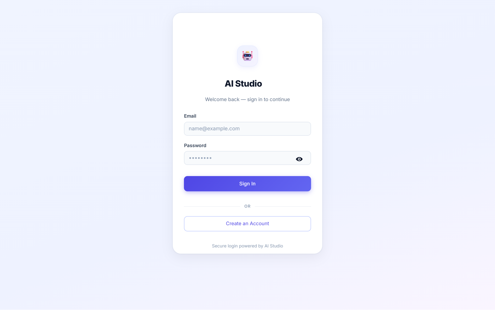
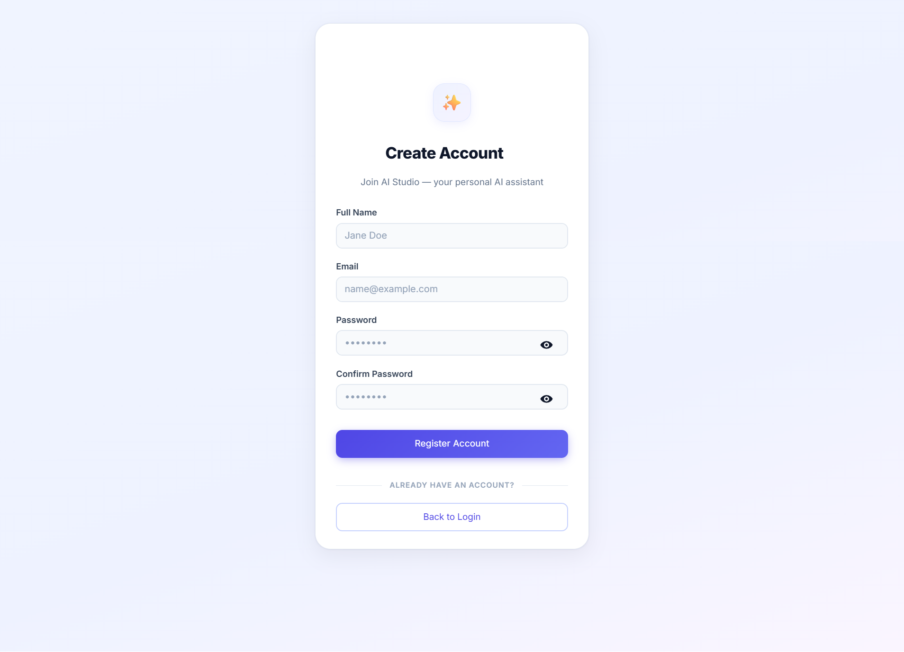
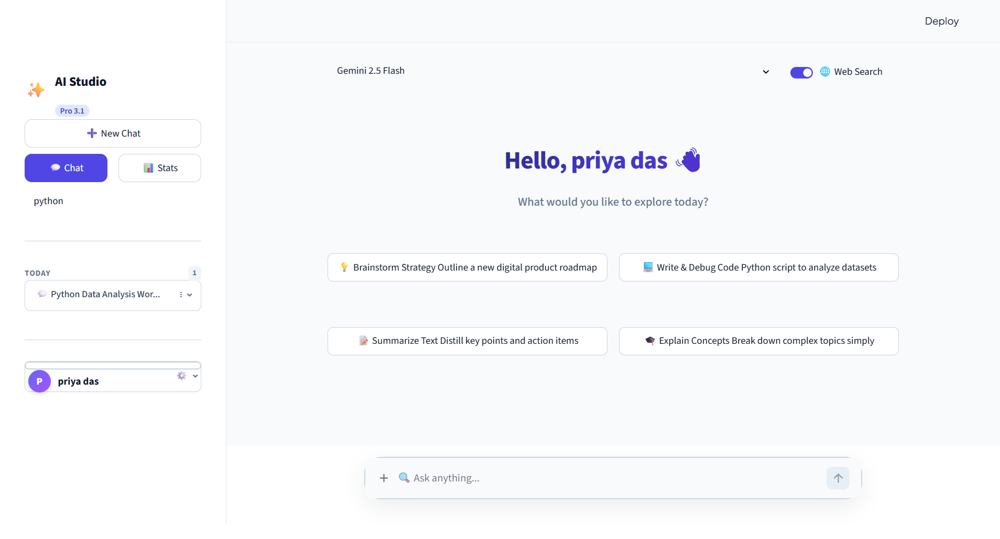
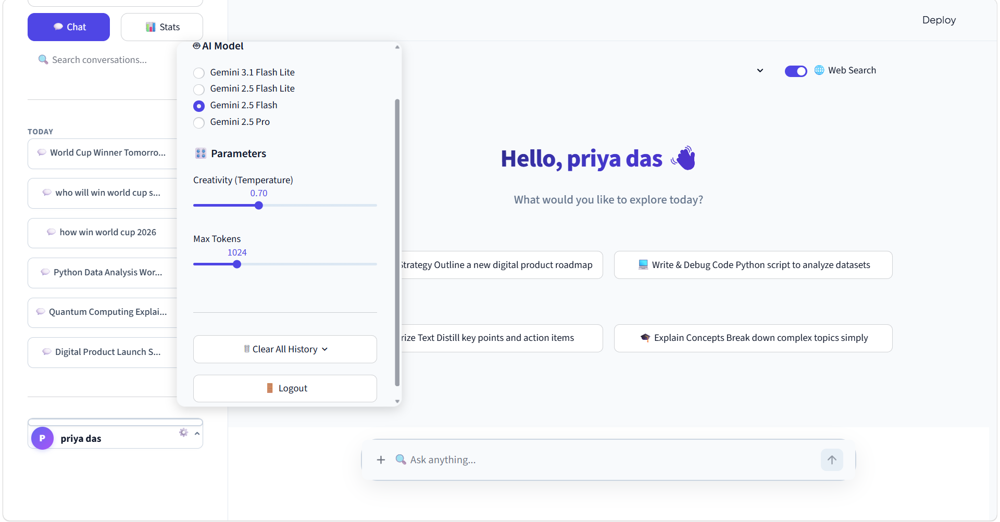
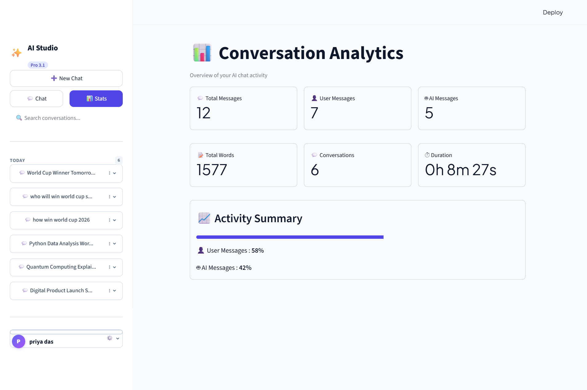
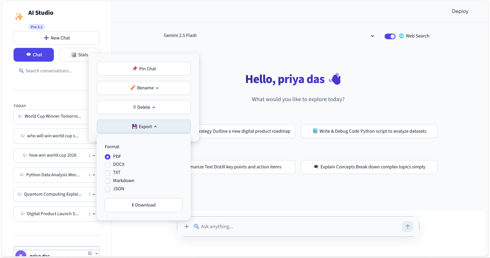

# 🤖 NehaGPT

<p align="center">
  <strong>An AI-Powered Chatbot built with Python, Streamlit, Google Gemini AI, and MySQL.</strong>
</p>

<p align="center">
  NehaGPT is a modern ChatGPT-inspired AI assistant that provides secure authentication, intelligent conversations, file analysis, YouTube transcript support, analytics, and chat export functionality.
</p>

---

## 📖 Overview

NehaGPT is a full-stack AI chatbot developed using **Python**, **Streamlit**, **Google Gemini AI**, and **MySQL**. It offers an intuitive conversational experience with secure user authentication, persistent chat history, AI-powered responses, file processing, analytics, and multiple export options.

The project demonstrates the integration of Generative AI with a modern web interface while following a clean, scalable, and user-friendly design.

---
# ✨ Features

### 🤖 AI Chat
- Google Gemini AI Integration
- Real-time AI Responses
- Multiple Chat Conversations
- Regenerate Responses
- AI Text Summarization
- Conversation Memory

### 🔐 Authentication
- User Registration
- Secure Login
- Password Hashing (BCrypt)
- Cookie-Based Session Management

### 💬 Conversation Management
- Create New Chats
- Rename Conversations
- Delete Conversations
- Pin Important Chats
- Search Chat History
- Persistent Database Storage

### 📁 File Support
- Image Upload
- Video Upload
- Document Upload
- AI Document Analysis
- YouTube Transcript Support

### 📊 Analytics
- Dashboard Overview
- Conversation Statistics
- User Activity Insights
- Interactive Charts

### 📤 Export Chats
- PDF
- DOCX
- TXT
- Markdown
- JSON

### 🎨 User Interface
- ChatGPT Inspired Design
- Responsive Sidebar
- User Profile
- Modern Streamlit Components
- Generation Settings

---

## 🛠️ Technology Stack

| Category | Technologies |
|----------|--------------|
| **Programming Language** | Python |
| **Frontend** | Streamlit |
| **AI Model** | Google Gemini API |
| **Database** | MySQL |
| **Authentication** | BCrypt |
| **Data Processing** | Pandas |
| **Visualization** | Matplotlib |
| **Image Processing** | Pillow |
| **Document Export** | ReportLab, python-docx |
| **Video Processing** | YouTube Transcript API |
| **Environment Management** | python-dotenv |
| **Session Management** | streamlit-cookies-manager |

---

## 📂 Project Structure

```text
NehaGPT/
│
├── app.py                 # Main Streamlit application
├── chatbot.py             # Gemini AI integration
├── auth.py                # Authentication logic
├── database.py            # Database operations
├── analytics.py           # Dashboard analytics
├── sidebar.py             # Sidebar components
├── login.py               # Login & registration UI
├── utils.py               # Helper functions
├── style.css              # Custom styling
├── history.json           # Conversation history
├── uploads/               # Uploaded files
├── requirements.txt       # Project dependencies
├── .env                   # Environment variables (not pushed to GitHub)
├── .gitignore             # Git ignored files
└── README.md              # Project documentation
```


---

# 🏗️ System Architecture

```text
                 User
                   │
                   ▼
          ┌────────────────┐
          │  Streamlit UI  │
          └────────────────┘
                   │
       ┌───────────┼───────────┐
       ▼           ▼           ▼
 Authentication   Chatbot   Analytics
       │           │           │
       └───────────┼───────────┘
                   ▼
          Google Gemini API
                   │
                   ▼
            MySQL Database
```
---
## 🚀 Getting Started

Follow the steps below to set up and run the project on your local machine.

---
## 1. Prerequisites

Before you begin, make sure you have the following installed:

- Python 3.10 or later
- MySQL Server
- Git
- Google Gemini API Key

---

### 2. Create a Virtual Environment

**Windows**

```bash
python -m venv env

env\Scripts\activate
```
---

### 3. Install Dependencies

```bash
pip install -r requirements.txt
```

---

### 4. Configure Environment Variables

Create a `.env` file in the project root and add your Gemini API key:

```env
GEMINI_API_KEY=YOUR_GEMINI_API_KEY
```

Also configure your MySQL database credentials in the project.

---

### 5. Run the Application

```bash
streamlit run app.py
```

After running the command, open your browser and visit:

```
http://localhost:8501
```
---

## 🗄️ Database Setup

NehaGPT uses **MySQL** as its database.

### 1. Start MySQL Server

Make sure your MySQL server is running.

### 2. Create a Database

Open MySQL and execute:

```sql
CREATE DATABASE ai_chatbot;
```

### 3. Configure Database Credentials

Update your database configuration with your MySQL credentials.

```python
host = "localhost"
user = "root"
password = "YOUR_PASSWORD"
database = "ai_chatbot"
```

Or, if you are using environment variables, add the following to your `.env` file:

```env
DB_HOST=localhost
DB_USER=root
DB_PASSWORD=YOUR_PASSWORD
DB_NAME=ai_chatbot
```

# 📋 Functionalities

- User Authentication
- AI Chat Assistant
- Conversation History
- Chat Search
- File Upload
- Image Upload
- Video Upload
- YouTube Transcript Analysis
- Analytics Dashboard
- Export Conversations
- Chat Pinning
- AI Summarization
- Response Regeneration

---


# 📸 Screenshots

### 🔐 Login Page
The secure login interface where registered users can sign in using their credentials. Passwords are securely encrypted using BCrypt, and user sessions are managed with cookies for a seamless experience.



### 📝 Register Page
The user registration page allows new users to create an account by providing the required information. Passwords are securely hashed before being stored in the database.



### 🏠 Home Page
The main dashboard of NehaGPT, featuring a clean ChatGPT-inspired interface. Users can start new conversations, access previous chats, upload files, and interact with the AI assistant.


### 💬 Chat Section
The conversation interface where users communicate with Google Gemini AI. It supports intelligent responses, conversation history, response regeneration, text summarization, and context-aware interactions.


### 🌐 Web Search
The integrated web search feature allows the AI assistant to retrieve up-to-date information from the internet, enabling more accurate and relevant responses for user queries.


### 🔍 Search Conversations
Users can quickly search through their conversation history to locate previous chats using keywords, making chat management simple and efficient.




### ⚙️ Settings
The settings panel provides options to customize the AI experience, including model selection, generation parameters (Temperature, Top-P, Top-K, Max Tokens), and other application preferences.



### 📊 Analytics Dashboard
An interactive dashboard displaying chat statistics and user activity. It includes visual charts and insights to help users analyze conversation trends and application usage.




### 📌 Conversation Management
Users can efficiently organize their conversations by pinning important chats, renaming conversations, deleting unwanted chats, and exporting conversations in multiple formats such as PDF, DOCX, TXT, Markdown, and JSON.



# 👩‍💻 Author

**Neha Kumari**
